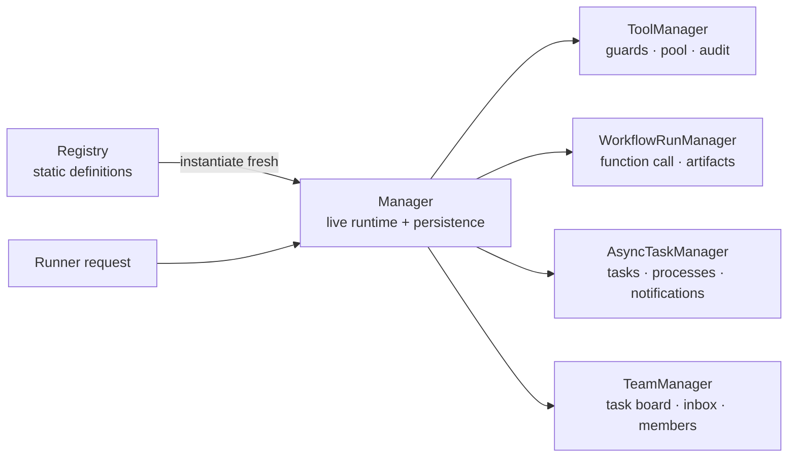

# Runtime Managers

> [简体中文](README.zh-CN.md)

`core/managers/` owns mutable runtime state. Registries only resolve and validate static definitions; Runner only routes requests to managers.

| Manager | Owns | Durable data | Recovery behavior |
| --- | --- | --- | --- |
| `AgentManager` (`core/agent/manager.py`) | live Agents, checkpoints, transcript; usage collection, persistence and totals | Agent manifest, `session.json`, `agents/model_usage.jsonl` | restores context and independent token records; scorers are injected again at runtime |
| `ToolManager` | tool pool, bound permission/cancel context, call records | `tool_calls.jsonl` | restores audit identifiers only; never recreates a Tool from an audit record |
| `WorkflowRunManager` | workflow context, inner agent dispatcher, artifacts | artifacts in `<runner_root>/workflows/<name>-<id>/` | stateless function call; no persistence or recovery |
| `AsyncTaskManager` | task state, pool, subprocesses, notifications and task-output access | `registry.json`, task output files | active opaque callbacks become `killed(stale_on_recovery)`; notifications are replayed |
| `TeamManager` | Team tasks, dependencies, eligibility, claims, inboxes, members and finish gate | `team.json` | failed member work remains `in_progress` with an error for root review; saved message IDs can be reconciled and acknowledged |

Managers take explicit state paths and callback/event-sink injection. They do not import or retain a Runner instance, and no manager reads static YAML.

For per-step candidate selection, `AgentManager` checkpoints every generated
proposal before the selected tool/code action executes. Rejected siblings keep
their model output, usage, score and error for inspection. Execution updates the
selected node in place, and subsequent requests follow its single active leaf.
Compression preserves candidate history while projecting only the selected
branch (or its summary) into model messages.

Models return per-call `usage_calls`; Agent and strategy code explicitly report
results or exceptions to `AgentManager`. The Manager alone collects, persists,
and aggregates usage in `agents/model_usage.jsonl`, excluding prompts and
transcripts. `model_usage_records()` exposes records with kind, backend, model,
Agent identifiers, usage, and request ID; `token_usage()` provides totals by kind.
Runner delegates to that method. Include rejected candidates, retries, scoring
failures, known usage on cancellation, summaries, and calls without saved sessions.
Compression/resume preserve accounting; never add `ActionStep.usage` a second time.

Team writes are serialized across Manager instances and atomically persisted before `on_change` emits a `team_update` payload. A claim checks eligibility, dependencies and task status under the same lock. A message stays pending until its ID is present in a saved receiving session step and `ack_messages` confirms delivery. Root must review a failed task before changing its status or eligible members; active member work cannot be reassigned or deleted.

Task output is read through `AsyncTaskManager.read_output(task_id)`. Transports
must not import the private task-store format or construct background processes
themselves.

## Development conventions

- Construct Managers independently with explicit state paths and callbacks. Private execution helpers are fine, but the Manager owns state and live instances. Registry owns static declarations; Runner only schedules requests.
- Agent generation emits the internal `candidates` event before side effects. Only `AgentManager` inserts those siblings and persists them; `step_complete` updates the selected node instead of appending a second execution node. Candidate/context regressions belong in `tests/core/agent/`.
- Persist terminal state before notifying observers. Cancellation uses cooperative tokens and termination of known child processes rather than killing Python threads. Recovery cannot restart arbitrary callbacks; stale active tasks converge to visible terminal states and persisted notifications are replayed.
- Validate Team claims, dependencies, and inbox writes under one file lock and replace state atomically. Confirm a message ID only after its receiving session step is saved. Leave failed tasks `in_progress` with an error for root review; active member tasks cannot be reassigned or deleted.
- Gateways read task output through `AsyncTaskManager.read_output()`, and that Manager creates shell work. Put tests in `tests/core/managers/` covering success, failure/cancellation, recovery, and release.
