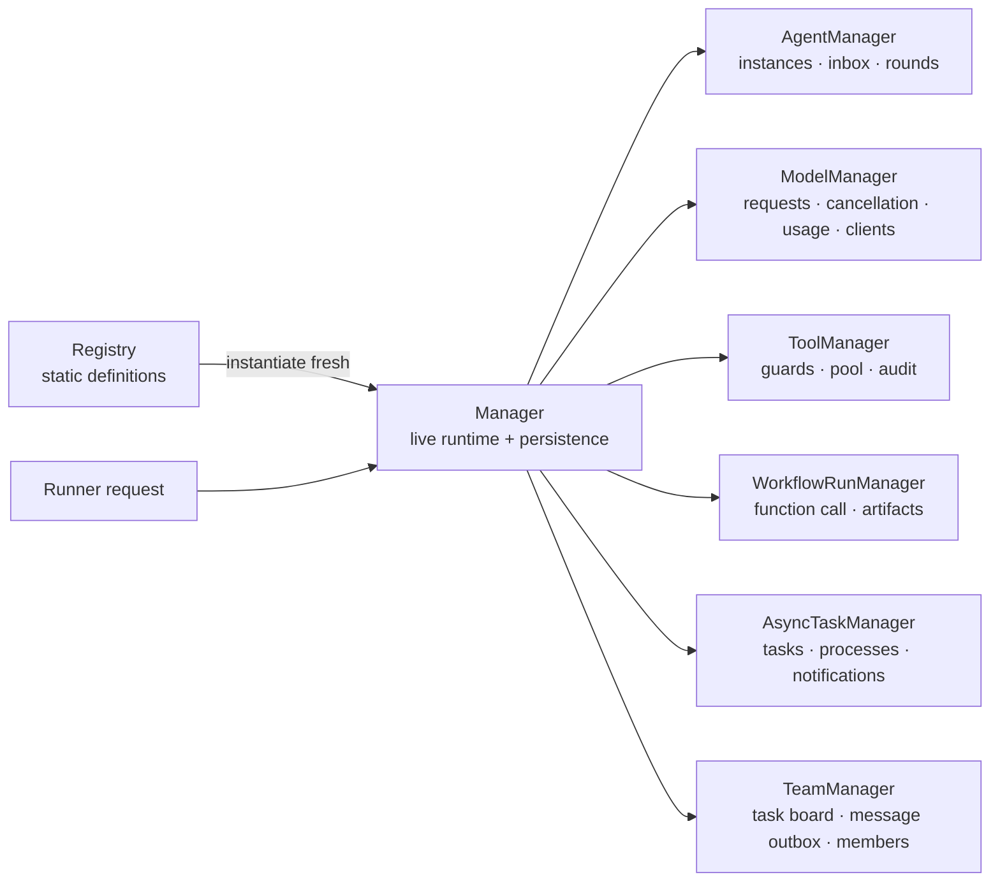

# Runtime Managers

> [简体中文](README.zh-CN.md)

`core/managers/` owns mutable runtime state. Registries only resolve and validate static definitions; Runner only routes requests to managers.

| Manager | Owns | Durable data | Recovery behavior |
| --- | --- | --- | --- |
| [AgentManager](agents/README.md) | live Agents, inbox scheduling, checkpoints, transcript | Agent manifest, `session.json` | restores context and rounds; scorers are injected at runtime |
| `ModelManager` | model calls, request events, cancellation, usage ledger and owned clients | `agents/model_usage.jsonl` | restores independent usage records; clients are created at runtime |
| `ToolManager` | tool pool, bound permission/cancel context, call records | `tool_calls.jsonl` | restores audit identifiers only; never recreates a Tool from an audit record |
| `WorkflowRunManager` | workflow context, inner agent dispatcher, artifacts | artifacts in `<runner_root>/workflows/<name>-<id>/` | stateless function call; no persistence or recovery |
| `AsyncTaskManager` | task state, coroutine concurrency, subprocesses, notifications and task-output access | `registry.json`, task output files | active opaque callbacks become `killed(stale_on_recovery)`; notifications are replayed |
| `TeamManager` | Team tasks, dependencies, eligibility, claims, message outbox, members and finish gate | `team.json` | TeamManager reconciles Agent checkpoints and restores active claims; committed message IDs reconcile acknowledgement |

Managers take explicit state paths and callback/event-sink injection. They do not import or retain a Runner instance, and no manager reads static YAML.

`ToolManager` runs a validated ReAct action batch concurrently by default, with
8 foreground workers. `ToolExecutionPolicy.mode` defaults to
`ToolExecutionMode.FOREGROUND`; strict mode requires custom tools to implement
`execution_policy(args, context)`, where returning `ToolExecutionPolicy()` is
sufficient for ordinary foreground calls. `BACKGROUND` returns a launch receipt
while the task continues, and `BARRIER` drains preceding foreground work before
executing on the request thread. Resource locks serialize calls sharing a protected resource.
These are technical constraints; model-authored dependencies belong in separate
steps. Completion events stream as calls finish, while the batch results retain
the original action order. CodeAct's ordinary Python calls keep statement order.
File tools lock by path, Python tools by executor instance, and Shell calls with
an explicit `workdir` retain their directory lock. File-cache metadata uses a
short lock so separate files can still perform I/O concurrently.

For per-step candidate selection, `AgentManager` checkpoints every generated
proposal before the selected tool/code action executes. Rejected siblings keep
their model output, usage, score and error for inspection. Execution updates the
selected node in place, and subsequent requests follow its single active leaf.
Compression preserves candidate history while projecting only the selected
branch (or its summary) into model messages.

Models return per-call `usage_calls`; Agent and strategy code explicitly report
results or exceptions to `ModelManager`, with identity supplied by `AgentManager`.
`ModelManager` alone collects, persists,
and aggregates usage in `agents/model_usage.jsonl`, excluding prompts and
transcripts. `model_usage_records()` exposes records with kind, backend, model,
Agent identifiers, usage, and request ID; `token_usage()` provides totals by kind.
Runner delegates to that method. Include rejected candidates, retries, scoring
failures, known usage on cancellation, summaries, and calls without saved sessions.
Compression/resume preserve accounting; never add `ActionStep.usage` a second time.

Team writes are serialized across Manager instances and atomically persisted before `on_change` emits a `team_update` payload. A claim checks eligibility, dependencies and task status under the same lock. A message stays pending until its ID is present in a saved receiving session step and `ack_messages` confirms delivery. Root must review a failed task before changing its status or eligible members; active member work cannot be reassigned or deleted.

`AgentManager.post(agent_id, attachment)` owns runtime inbox persistence and round
scheduling for user, Team and async messages. Team business records remain an
outbox until the receiving context commits. Broadcast with
`send_message(recipient="*", text="Review the result")`: recipients are the
current active peers including root, excluding the sender. Each copy freezes its
Team run and member generation and has an independent message ID and receipt.
Delivery failures remain visible; closing a member redirects pending unicast to
root and marks broadcast copies failed. See [Team conventions](team/README.md).

Async terminal state and the complete pending notification are committed in one
atomic registry replacement. Replay retains the original event/message ID,
summary and result; only a receiving context commit acknowledges it. A delivery
failure leaves the task outcome intact and records `notification.delivery_error`.
Recovery closes vanished callbacks with a durable cancellation notification.

Task output is read through `AsyncTaskManager.read_output(task_id)`. Transports
must not import the private task-store format or construct background processes
themselves. Shell workers drain stdout/stderr during execution; on POSIX,
cancellation and timeouts stop the owned process group, including descendants.

## Development conventions

- Construct Managers independently with explicit state paths and callbacks. Private execution helpers are fine, but the Manager owns state and live instances. Registry owns static declarations; Runner only schedules requests.
- Tool implementations must tolerate concurrent foreground calls. Use resource locks for shared mutable state and `BARRIER` for required main-thread work; do not encode workflow dependencies as tool policies. Preserve per-call guards, cancellation, audit records and original result order when changing batch execution.
- Agent generation emits the internal `candidates` event before side effects. Only `AgentManager` inserts those siblings and persists them; `step_complete` updates the selected node instead of appending a second execution node. Candidate/context regressions belong in `tests/core/agent/`.
- Persist terminal state before notifying observers. Cancellation uses cooperative tokens and termination of known child processes rather than killing Python threads. Recovery cannot restart arbitrary callbacks; stale active tasks converge to visible terminal states and persisted notifications are replayed.
- Validate Team claims, dependencies, and inbox writes under one file lock and replace state atomically. Confirm a message ID only after its receiving session step is saved. Leave failed tasks `in_progress` with an error for root review; active member tasks cannot be reassigned or deleted.
- Gateways read task output through `AsyncTaskManager.read_output()`, and that Manager creates shell work. Put tests in `tests/core/managers/` covering success, failure/cancellation, recovery, and release.

## Async execution conventions

I/O execution uses `a*` APIs: `AgentManager.arun/astream`, `ModelManager.acall`,
`ToolManager.aexecute/aexecute_streaming`, `WorkflowRunManager.acall`,
`AsyncTaskManager.alaunch/acancel/aclose`, and `TeamManager.awake/asend_message`.
Pure validation, state projections and in-memory computation stay synchronous.
Sync tools and atomic file transactions run outside the event loop. Cancellation
awaits started model/tool/child cleanup; manager shutdown releases owned resources.
Sync entry points adapt complete operations rather than bridging every model request.
