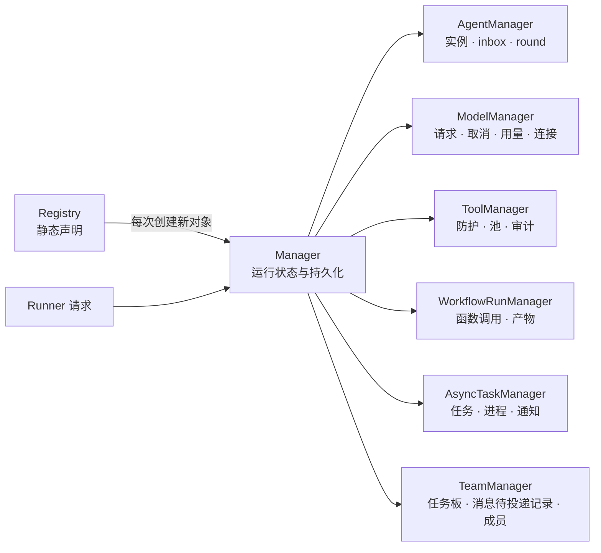

> [English](README.md)

# 运行时 Managers

`core/managers/` 持有可变运行状态。Registry 只解析和校验静态声明，Runner 只把请求分发给 Managers。

| Manager | 所有权 | 持久数据 | 恢复行为 |
| --- | --- | --- | --- |
| [AgentManager](agents/README.zh-CN.md) | live Agent、inbox 调度、检查点、执行记录 | Agent manifest、`session.json` | 恢复上下文和 round；评分器运行时注入 |
| `ModelManager` | 模型调用、请求事件、取消、用量账本及自建连接 | `agents/model_usage.jsonl` | 恢复独立用量记录，连接在运行时创建 |
| `ToolManager` | 工具池、绑定的权限/取消上下文、调用记录 | `tool_calls.jsonl` | 只恢复审计标识；不会从审计记录重建 Tool |
| `WorkflowRunManager` | workflow context、内部 agent 调度器、产物 | `<runner_root>/workflows/<name>-<id>/` 中的产物 | 无状态函数调用；无持久化或恢复 |
| `AsyncTaskManager` | 任务状态、协程并发、子进程、通知及输出读取 | `registry.json`、任务输出文件 | 不透明的活跃回调变为 `killed(stale_on_recovery)`；重放通知 |
| `TeamManager` | Team 任务、依赖、资格、领取、消息待投递记录、成员及完成门控 | `team.json` | TeamManager 对账 Agent 检查点并恢复活跃领取；按已提交的消息 ID 对账确认 |

Manager 通过明确的状态路径及回调/event sink 注入进行构造。它们不导入或持有 Runner 实例，也不读取静态 YAML。

`ToolManager` 默认并发执行校验通过的一批 ReAct actions，前台 worker 数默认为 8。
`ToolExecutionPolicy.mode` 默认使用 `ToolExecutionMode.FOREGROUND`；严格模式要求
自定义工具实现 `execution_policy(args, context)`，普通前台调用返回
`ToolExecutionPolicy()` 即可。`BACKGROUND` 返回启动回执后继续运行任务；
`BARRIER` 等待此前前台工作完成，再在请求线程执行。
资源锁会串行化访问同一受保护资源的调用。这些约束用于满足工具的技术
要求；模型编排中的先后依赖应拆到不同 step。完成事件按实际完成顺序流出，批量
结果仍保持原 action 顺序。CodeAct 的普通 Python 调用仍按语句顺序执行。
文件工具按路径加锁，Python 工具按执行器实例加锁；Shell 显式指定 `workdir` 时
保留目录锁。文件缓存元数据只持有短锁，不限制不同文件的并发 I/O。

每步候选选择由 `AgentManager` 在工具/代码执行前保存全部候选。淘汰兄弟节点保留模型输出、usage、评分和错误；执行结果更新到选中节点，后续请求沿唯一活跃叶子继续。压缩保留候选历史，仅将选中分支或其摘要投影到模型消息。

Models 返回本次 `usage_calls`，Agent 和策略将结果或异常显式上报给 `AgentManager`。
由 `AgentManager` 绑定身份，`ModelManager` 统一收集、持久化及汇总，写入 `agents/model_usage.jsonl`，不含 prompt 或 transcript。
`model_usage_records()` 提供用途、backend、模型、Agent 标识、用量和请求 ID 明细；
`token_usage()` 按用途汇总，Runner 仅代理它。淘汰候选、重试、评分失败、取消前已知用量、
摘要及无持久化 session 的调用均纳入。压缩与恢复保留统计，不重复累计 `ActionStep.usage`。

多个 TeamManager 实例之间的写入会串行化，并在 `on_change` 发出 `team_update` 前原子持久化。领取任务时，在同一把锁下检查资格、依赖和状态。消息 ID 只有在接收方 session step 已保存且 `ack_messages` 确认后才会清除待投递状态。root 必须先审核失败任务，才能修改其状态或可执行成员；运行中的成员任务不可改派或删除。

用户、Team 和异步通知统一交给 `AgentManager.post(agent_id, attachment)`，
由其持有运行时 inbox 并调度 round。Team 业务消息在接收方上下文提交前保留待确认。
`send_message(recipient="*", text="请审核结果")` 在发送时冻结有效成员，包含 root、
排除发送者；每份副本绑定 Team run 和成员 generation，具有独立 ID 与回执。
关闭成员时，单播转交 root，广播副本保留可见失败。详见 [Team 约定](team/README.zh-CN.md)。

异步终态与完整待投递通知通过同一次 registry 原子替换提交；恢复重放保留原始
event/message ID、摘要和结果，接收方上下文提交后才确认。投递失败保留任务原有终态，
错误记录在 `notification.delivery_error`。已消失的后台回调恢复为终止状态和持久通知。

任务输出通过 `AsyncTaskManager.read_output(task_id)` 读取。传输层不能导入私有任务存储格式，也不能自行创建后台进程。shell 执行期间持续排空 stdout/stderr；POSIX 下取消和超时会终止所属进程组及其子进程。

## 开发约定

- 使用显式状态路径和回调独立构造 Manager。可以使用私有执行辅助类，但状态和 live 实例仍归 Manager 所有。Registry 管静态声明，Runner 负责调度请求。
- 工具实现必须支持并发前台调用。共享可变状态使用资源锁，必须在主线程执行的工作使用 `BARRIER`；不要通过工具策略表达业务先后依赖。修改批量执行时保留每次调用的防护、取消和审计记录，并保持结果顺序。
- Agent 在副作用前发出内部 `candidates` 事件，只有 `AgentManager` 添加并持久化兄弟节点；`step_complete` 更新选中节点，避免重复添加执行节点。候选与上下文回归测试放在 `tests/core/agent/`。
- 先持久化终态，再通知观察者。取消使用协作式 token 并终止已知子进程，不强杀 Python 线程。恢复时无法重启任意回调；遗留活跃任务需收敛到可见终态，并重放持久通知。
- Team 领取、依赖和收件箱写入需在同一文件锁下校验并原子替换。接收方 session step 保存后才确认消息 ID。失败任务保留 `in_progress` 及错误供 root 审核，活跃成员任务不可改派或删除。
- 网关通过 `AsyncTaskManager.read_output()` 读取任务输出，由该 Manager 创建 shell 工作。测试放在 `tests/core/managers/`，覆盖成功、失败/取消、恢复和释放。

## 异步执行约定

I/O 执行接口使用 `a*`：`AgentManager.arun/astream`、`ModelManager.acall`、
`ToolManager.aexecute/aexecute_streaming`、`WorkflowRunManager.acall`、
`AsyncTaskManager.alaunch/acancel/aclose`、`TeamManager.awake/asend_message`。
纯校验、状态投影和内存计算保持同步；同步工具与原子文件事务离开事件循环执行。
取消需要等待已启动的模型、工具和子任务完成清理，关闭 Manager 才释放其资源。
同步入口仅适配完整操作，不在每次模型请求之间反复桥接。
