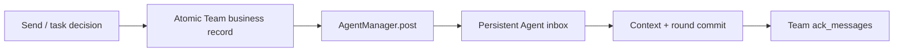

# Team business state

> [简体中文](README.zh-CN.md)

`TeamManager` owns `team.json`: task board, frozen eligibility, members and
message delivery records. `AgentManager` owns each Agent's runtime inbox and
serial round scheduling.

```python
manager.send_message("alice", "root", "Ready for review")
receipts = manager.send_message("alice", "*", "Review the result")
# {"broadcast_id": "...", "receipts": [{"message_id": "...", "to": "root", ...}]}
```



- Broadcast recipients are a snapshot of active peers, including root and
  excluding the sender. Each copy has its own ID and acknowledgement; an empty
  snapshot succeeds. Later members receive no historical copies.
- Every message freezes `team_run_id` and `target_generation`. Validate with
  `message_target_valid()` before posting; record permanent failures with
  `mark_message_failed()`. Failures stay inspectable and leave the pending set.
- Closing a member redirects pending unicast to root. Broadcast copies fail
  instead, preventing duplicate delivery to root. Restarting invalidates pending
  copies addressed to the previous generation.
- The JSON replacement and validation share one file lock. Observers run after
  commit; a failed recipient does not undo other copies. `ack_messages()` runs
  only after the receiving Agent context is saved.
- Runner calls `recover(preserve_claims=True)` after loading Agent checkpoints.
  It clears stale busy flags while preserving active task claims. Standalone
  recovery without checkpoints leaves active claims for root review.

Functional tests live in `tests/core/managers/test_team_manager.py` and
`tests/core/runner/test_team_runtime.py`.

`runtime.py` owns member acquisition, eligible-task dispatch, message delivery,
round-result reconciliation, restart/close and finish cleanup. Runner binds an
AgentManager, a weak root resolver and a config loader through `bind_runtime()`;
it retains no second dispatch loop. Use `await manager.awake()` and
`await manager.asend_message(...)` in async hosts. File transactions execute
outside the loop and all actual rounds remain AgentManager-owned.
