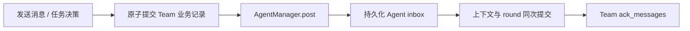

> [English](README.md)

# Team 业务状态

`TeamManager` 持有 `team.json` 中的任务板、冻结资格、成员及消息投递记录。
各 Agent 的运行时 inbox 和 round 串行调度由 `AgentManager` 统一持有。

```python
manager.send_message("alice", "root", "请审核结果")
receipts = manager.send_message("alice", "*", "结果已就绪")
# {"broadcast_id": "...", "receipts": [{"message_id": "...", "to": "root", ...}]}
```



- 广播在发送时冻结有效接收者，包含 root、排除发送者。各副本有独立 ID 和确认；
  零接收者成功返回空回执，新成员不补发历史消息。
- 每条消息绑定 `team_run_id` 和 `target_generation`；投递前使用
  `message_target_valid()` 校验，永久失败由 `mark_message_failed()` 记录。
  失败保持可见并退出待投递集合。
- 关闭成员时，待确认单播转交 root；广播副本标记失败，避免 root 重复接收。
  重启会使投给旧 generation 的待投递记录失效。
- 校验和 JSON 原子替换使用同一文件锁，提交后才调用观察者。单个接收者失败
  不回滚其他副本。接收方 Agent 上下文保存后才调用 `ack_messages()`。
- Runner 加载 Agent 检查点后调用 `recover(preserve_claims=True)`，清除旧 busy
  标记并保留活跃领取。没有 Agent 检查点的独立恢复保留领取及错误供 root 审核。

功能测试位于 `tests/core/managers/test_team_manager.py` 和
`tests/core/runner/test_team_runtime.py`。

`runtime.py` 负责成员获取、可执行任务分派、消息投递、round 结果对账、成员重启/
关闭和结束清理。Runner 通过 `bind_runtime()` 注入 AgentManager、弱引用 root
解析器及配置加载器，不再保留另一套分派循环。异步宿主使用
`await manager.awake()`、`await manager.asend_message(...)`；文件事务离开循环执行，
实际 round 始终归 AgentManager。
