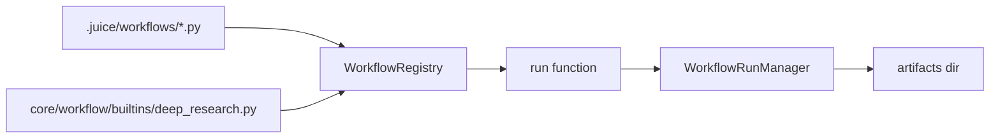
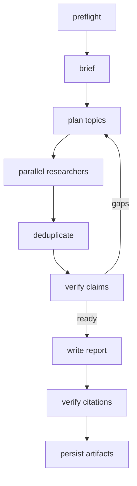

# Workflow

> [简体中文](README.zh-CN.md)

`sdk/src/juice_agents/core/workflow` is Juice's native workflow runtime. A Workflow is a deterministic orchestration script that Agents can write, call, and debug. Workflows are called as functions: they run once, return a result, and produce artifacts. No persistent run state, no pause/resume — just function semantics.

## Architecture



| Module | Responsibility |
| --- | --- |
| `context.py` | `WorkflowContext`: artifact writing, inner agent calls, lifecycle events |
| `types.py` | `WorkflowBuildContext`, `WorkflowAgentDispatcher`, error types |
| `core/managers/workflows.py` | `WorkflowRunManager.call()`: validate, load, execute, return result |
| `registry/workflows/registry.py` | Built-in/local discovery, local overrides, AST safety checks |
| `builtins/deep_research.py` | The first built-in business workflow |

## Single-file Workflow

```python
from typing import Any
from juice_agents.core.workflow import WorkflowContext

WORKFLOW_METADATA = {
    "name": "counter",
    "description": "Increment a value.",
    "read_only": True,
    "input_schema": {"value": "integer"},
    "output_schema": {"result": "integer"},
}

def run(ctx: WorkflowContext, args: dict[str, Any]) -> dict[str, Any]:
    """Single-function workflow: validate args, compute, return."""
    value = args.get("value", 0)
    result = value + 1
    
    # Write artifacts
    ctx.artifact("result.txt", str(result))
    
    return {"result": result}
```

Workspace workflows live at `.juice/workflows/<name>.py` and override a built-in with the same name. Local workflows cannot access files, shells, networks, or dangerous imports directly; external actions must use permission-controlled Agents via `ctx.agent()`.

Discovery, validation, and execution read built-ins directly without creating workspace files. `workflow_manage(action="edit", name="deep_research", content=source)` validates the complete replacement as local source, then atomically saves the first override. Unknown names and invalid source fail before writing. Removing a local override restores the built-in definition; packaged scripts remain read-only.

## Deep Research

`deep_research` is a multi-phase research workflow using temporary inner agents:



- Source modes: `web`, `workspace`, and `web_workspace`.
- The input field is `source_mode`; unknown modes fail directly.
- Brief classifies questions as `simple`, `multi_part`, or `broad`. Simple questions start one researcher; others run bounded parallel research.
- A claim is verified by one authoritative source or two independent, non-conflicting sources.
- Disputed or unverified claims appear only in limitations, never as report facts.
- A researcher must open or read a source before citing it; search snippets are leads, not evidence.
- Artifacts: `report.md`, `sources.json`, `claims.json`, `debug.json`.
- Brief, supervisor, researcher, and writer are spawned via `ctx.agent()` with temporary instructions, tools, and output schemas.

Architecture informed by [Open Deep Research](https://github.com/langchain-ai/open_deep_research) and [Claude Code Dynamic workflows](https://code.claude.com/docs/zh-CN/workflows). Implementation rewritten with Juice APIs.

## Calling Workflows

After saving the `counter` example above to `.juice/workflows/counter.py`, call it through the Runner’s `WorkflowRunManager`:

```python
from juice_agents import Juice

juice = Juice(workspace=".")
runner = juice.runners.create(runner_config="agent")

result = runner.workflow_manager.call("counter", {"value": 1})
print(result["result"])  # {"result": 2}
# artifacts_dir is a string path, or "" if no artifact was written.
```

To invoke a workflow through an agent:

```python
result = runner.run("$workflow:deep_research Research recent AI breakthroughs using web sources")
```

Users invoke workflows explicitly via `$workflow:<name>` syntax. The agent receives the workflow's metadata and can execute it via the `workflow_run` tool. The agent will gather required parameters (like `source_mode`) through conversation.

## Artifacts

Workflows write artifacts via `ctx.artifact(name, content)`:

```python
def run(ctx: WorkflowContext, args: dict[str, Any]) -> dict[str, Any]:
    report = "# Research Report\n..."
    ctx.artifact("report.md", report)
    ctx.artifact("sources.json", [{"title": "Example source"}])
    return {"summary": "Complete"}
```

Artifacts land in `<runner_root>/workflows/<name>-<call_id>/`:

```text
.juice/runners/<runner_id>/workflows/deep_research-a1b2c3/
├── report.md
├── sources.json
├── claims.json
└── debug.json
```

## Inner Agents

Workflows spawn temporary agents via `ctx.agent()`:

```python
result = ctx.agent(
    task="Search for recent AI breakthroughs",
    instructions="Find and summarize reliable sources.",
    tools=["web_search", "browser_open_url"],  # Tool restrictions
    schema={"type": "object", "properties": {"findings": {"type": "array", "items": {"type": "string"}}}},
    max_steps=10,                 # Step limit
    phase="Research",             # Lifecycle phase label
    label="AI trends"             # Agent label for logging
)
# Returns the agent output; with schema, this is a dict.
```

Specify `agent` (a registered agent configuration) or nonempty `instructions`. Tools must be declared in `WORKFLOW_METADATA.tools`; read-only workflows can use only read-only tools.

Inner agents:
- Do not persist beyond the workflow call
- Cannot spawn their own child agents
- Inherit the workflow's cancellation signal
- Are logged in the workflow's lifecycle events

## Configuration

```yaml
# .juice/config.yaml
workflows:
  enabled: true  # Disable to hide workflow tools from agents
```

When `workflows.enabled=false`, agents cannot call workflows automatically, but `$workflow:` explicit invocations still work.

## Development Conventions

- Workflow files belong in workspace `.juice/workflows/*.py` or built-in `workflow/builtins/`. Local scripts cannot access shells, files, or networks directly; external actions go through `ctx.agent()`.
- `WorkflowRunManager` owns execution and artifacts. Workflows call Runner-managed Agents through `ctx.agent()` and never create child Runners.
- Root can manage workflows; ordinary child Agents cannot create or modify workflow scripts when `self_evolution.enabled=false`.
- Workflows are synchronous function calls. For long-running workflows, use `AsyncTaskManager` to wrap the call (the `local_workflow` task type).
- Cancellation propagates via `ctx.cancel_event`. Check periodically for cooperative shutdown.
- Deep Research accepts `source_mode` only. Snippets are not evidence; only `verified_claims` enter report prose. Tests belong in `tests/core/workflow/`.
