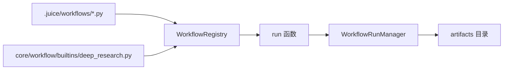
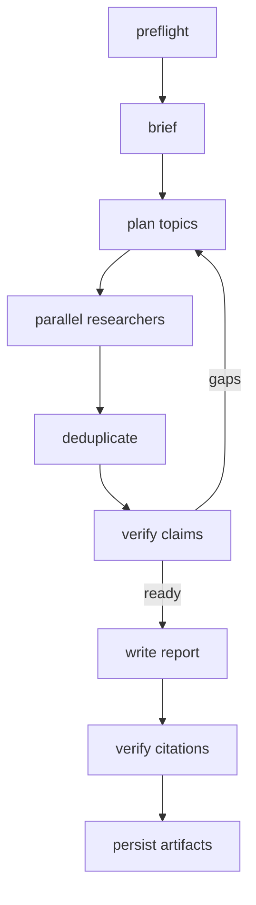

> [English](README.md)

# Workflow

`sdk/src/juice_agents/core/workflow` 是 Juice 原生工作流运行时。Workflow 的定位是 Agent 可编写、可调用、可调试的确定性编排脚本。Workflow 按函数调用：执行一次，返回结果，产生产物。无持久运行状态，无 pause/resume — 纯函数语义。

## 架构



| 模块 | 职责 |
| --- | --- |
| `context.py` | `WorkflowContext`：产物写入、内部 agent 调用、生命周期事件 |
| `types.py` | `WorkflowBuildContext`、`WorkflowAgentDispatcher`、错误类型 |
| `core/managers/workflows.py` | `WorkflowRunManager.call()`：校验、加载、执行、返回结果 |
| `registry/workflows/registry.py` | builtin/local 发现、local 覆盖、AST 安全校验 |
| `builtins/deep_research.py` | 首个 builtin 业务 workflow |

## 单文件 Workflow

```python
from typing import Any
from juice_agents.core.workflow import WorkflowContext

WORKFLOW_METADATA = {
    "name": "counter",
    "description": "递增一个值。",
    "read_only": True,
    "input_schema": {"value": "integer"},
    "output_schema": {"result": "integer"},
}

def run(ctx: WorkflowContext, args: dict[str, Any]) -> dict[str, Any]:
    """单函数 workflow：校验参数、计算、返回。"""
    value = args.get("value", 0)
    result = value + 1
    
    # 写产物
    ctx.artifact("result.txt", str(result))
    
    return {"result": result}
```

Workspace workflow 放在 `.juice/workflows/<name>.py`，同名时覆盖 builtin。Local workflow 禁止直接访问文件、shell、网络和危险 import；外部动作必须通过 `ctx.agent()` 调用受权限控制的 Agent。

发现、校验和执行直接读取内置定义，不创建 workspace 文件。`workflow_manage(action="edit", name="deep_research", content=source)` 将完整替换源码按 local 规则校验，成功后原子保存首份本地覆盖；未知名称或非法源码在写入前失败。删除本地覆盖后恢复内置定义，包内脚本始终只读。

## Deep Research

`deep_research` 是使用临时内部 agent 的多阶段研究 workflow：



- 来源模式：`web`、`workspace`、`web_workspace`
- 输入字段固定为 `source_mode`；未知模式会直接报错
- brief 将问题归类为 `simple`、`multi_part`、`broad`；简单问题只启动一个 researcher，其他类型按需并行且不超过配置上限
- verified：一个权威来源，或两个独立来源且无冲突
- disputed/unverified：只进入 limitations，不进入报告事实
- researcher 必须打开或读取来源后才能引用；搜索 snippet 只作为线索，不作为证据
- 产物：`report.md`、`sources.json`、`claims.json`、`debug.json`
- brief/supervisor/researcher/writer 都通过 `ctx.agent()` 以临时 instructions、tools 和 output schema 生成

架构参考 [Open Deep Research](https://github.com/langchain-ai/open_deep_research) 与 [Claude Code Dynamic workflows](https://code.claude.com/docs/zh-CN/workflows)。实现使用 Juice API 重写。

## 调用 Workflow

Workflow 通过 `WorkflowRunManager.call()` 作为函数调用：

```python
from juice_agents import Juice

juice = Juice(workspace=".")
runner = juice.runners.create(runner_config="agent")

# 直接调用
result = juice.workflows.call(
    workflow="deep_research",
    args={"question": "AI trends 2024", "source_mode": "web"},
    config={"max_research_rounds": 2}
)

# 返回：{"result": {...}, "artifacts_dir": Path, "stats": {...}}
```

从 agent 调用：

```text
$workflow:deep_research 研究最新的 AI 突破
```

用户使用 `$workflow:<name>` 语法显式调用 workflow，agent 获得该 workflow 的元数据并可通过 `workflow_run` 工具执行。Agent 会通过对话获取所需的参数（如 `source_mode`）。

## 产物

Workflow 通过 `ctx.artifact(name, content)` 写产物：

```python
def run(ctx: WorkflowContext, args: dict[str, Any]) -> dict[str, Any]:
    report = "# 研究报告\n..."
    ctx.artifact("report.md", report)
    ctx.artifact("sources.json", json.dumps(sources))
    return {"summary": "完成"}
```

产物落在 `<runner_root>/workflows/<name>-<call_id>/`：

```text
.juice/runners/<runner_id>/workflows/deep_research-a1b2c3/
├── report.md
├── sources.json
├── claims.json
└── debug.json
```

## 内部 Agent

Workflow 通过 `ctx.agent()` 生成临时 agent：

```python
result = ctx.agent(
    task="搜索最新 AI 突破",
    agent="researcher",           # 可选 agent 配置名
    instructions="关注 2024",      # 可选自定义 instructions
    tools=["web_search", "browser_open_url"],  # 工具限制
    schema={"findings": "list"},  # 结构化输出 schema
    max_steps=10,                 # 步数限制
    phase="Research",             # 生命周期阶段标签
    label="AI trends"             # Agent 标签用于日志
)
# 返回：{"output": ..., "steps": int, "tokens": int}
```

内部 agent：
- 不在 workflow 调用之外持久化
- 不能生成自己的子 agent
- 继承 workflow 的取消信号
- 记录在 workflow 的生命周期事件中

## 配置

```yaml
# .juice/config.yaml
workflows:
  enabled: true  # 禁用以隐藏 agent 的 workflow 工具
```

当 `workflows.enabled=false` 时，agent 无法自动调用 workflow，但 `$workflow:` 显式调用仍然有效。

## 开发约束

- Workflow 文件只放在 workspace `.juice/workflows/*.py` 或内置 `workflow/builtins/`；本地脚本不直接访问 shell、文件和网络，外部动作交给 `ctx.agent()`。
- `WorkflowRunManager` 是执行与产物的唯一所有者。Workflow 通过 `ctx.agent()` 调 Runner 管理的 Agent，不创建子 Runner。
- root 可管理 workflow；`self_evolution.enabled=false` 时普通子 Agent 无法创建或修改 workflow 脚本。
- Workflow 是同步函数调用。长时间运行的 workflow 使用 `AsyncTaskManager` 包装调用（`local_workflow` 任务类型）。
- 取消通过 `ctx.cancel_event` 传播。定期检查以协作关闭。
- Deep Research 只接受 `source_mode`；snippet 不能直接作为证据，仅 `verified_claims` 进入报告正文。测试放 `tests/core/workflow/`。
